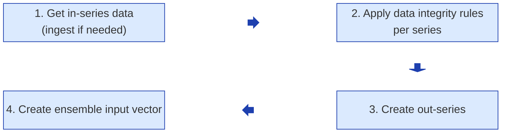

# Sempahore Domain Model
This page documents the domain model for Semaphore. The Semaphore domain model had evolved a lot since we first designed the platform. The current domain model is based on our experience operationalizing a variety of predictive models having a variety of requirements ranging from input creation (including data ingestion), "model" structure (i.e.,  member count, Input count, output count), to output requirements. The current domain model is not entirely reflected in the current implementation but is at least conceptually representative of the current implementation. 

The purpose of creating such a domain model is to provide a shared language between domain experts and engineers, which then guides naming of components in the code, database and configuraiton files. It may also be used to help in determining areas of Semaphore that would benefit from some refactoring to make it closer to the current domain model that it is implementing.

It makes sense to partition the domain model into 2 sub-domains: model execution and input vector creation.

## Model Execution
This sub-domain is all about executing models.
 

| Name | Definition | Notes |
| ----| ---- | ---- | 
| **Verified Time/Valid Time** | For predictions, quite literally, the time at which we will be able to verify the prediction.  Practically this means the time for which we are making the prediction. | For measurements, the verified time is the time at which the measurement was taken. |
| **Reference Time/Generated Time** | (This definition is when the term is used regarding inputs, not model runs). The time at which a prediction is made. | For measurements this is always the same as the verified time. Note that internally, Semaphore uses the term 'Reference Time' when running a model to indicate something different, but that is a different term that is more implementation detail than a domain model concept. |
| **Lead Time** | The delta between the reference time and the verified time. Basically, for predictions, how long in advance was the prediction made. ||
| **Model** | A neural net model that generates predictions for a particular lead time, location and predicted variable, a particular set of inputs and is represented by a given set of weights (typically one or more TensorFlow h5 or keras files) | In the context of Semaphore, 2 predictive models that are for the same lead time and location and predicted variable, and that use the same input vectors but are represented by distinct weights/TensorFlow files are considered 2 distinct models. A model may be an Ensemble Model or a Simple Model. |
| **Ensemble Model** | A specific type of model that contains multiple members. | The execution of this type of model consists in running each member in the ensemble against the ensemble input vector and gathering all resulting values into a single output.|
| **Ensemble Member** (or member for short) | A single member of an ensemble model. | Each member in a ensemble model has an associated set of weights (h5 or keras file) |
| **Simple Model** | A specific type of model that contains a single member. | Basically a special case of an ensemble model where there are only one ensemble member.|
| **Model Dimensions** | A 3-tuple specifying the 3 key aspects of a predictive model: the number of ensemble members (if not an ensemble model, this number will be 1), the number of input vectors members to feed the model (this determines the number of times each ensemble member will be executed, once per input vector member) and the number of outputs generated by each member run. | For example, a model dimensions of (1,1,1) represents a model that has a single member, where the single member is executed against a single input vector, and generates a single output per member run. A model dimensions of (10, 10, 100) represents a model that has 10 members, where each member is executed against 10 different input vectors, and where each member run generates 100 outputs. |
| **Ensemble Input Vector** | The set of input vectors that is used to execute a model. Models that use more than one input vector do so typically to predict a range of values based on a range of possible input predictions (e.g., a range of air temperature forecasts) | A model is executed by feeding each of its ensemble member each of the input vector in the ensemble input vector and recording all of the outputs.|
| **Input Vector Member** | A single member of an Ensemble Input Vector, represented by a single vector (1 dimensional array) in the application | The ordering of the data in an input vector member is crucial. See the `Ensemble Input Vector Creation` section for more information. |
| **Model Run**| The act of executing a model to generate an output. Consists in executing each ensemble member against an ensemble input vector. Key properties of a model run include: the model that was run, when the model was run, the time used as the `now` for the run (typically the top of the current hour), what outputs the model produced if any, whether the run was successful and, if not, why it failed | Although, at first glance, it seems that the primary concept in our domain model is the concept of a predictive model, in reality, Semaphore's primary concern is executing predictive models to generate outputs. Hence, the concept of a model run is key in the Semaphore implementation.|
|**Member Run**| The act of executing a single member of a model against a single input vector member. | This concept is important when discussing model run logic and implementation. However, it is not explicitly represented nor persisted in Semaphore as it is always part of a model run and cannot exist outside of a model run. It is implicitly represented in the shape of the output produced by a model run.|
| **Member Run Output** (or memnber output for short)| Each member run results in the generation of an output. This output can be a single value or a set of values. For example, a member run might only generate one value representing the prediction of an environment variable (e.g., water level) or could generate a set of predictions. Regardless of whether it is a single value or a tuple, the output generated by the member is called a member output. | A member run output that contains more than one value represents a set of possible predictions for the given lead time. |
| **Model Run Output** | The set of member run outputs generated by a model run. | In the case of ensemble models, this can be a lot of values. For example, for a model of dimensions (10,10,100) a single model run output contains 10,000 values. For a model with dimensions (10, 100,100) a model run output contains 100,000 values. |

## Ensemble Input Vector Creation
This sub-domain is about gathering all of the data necessary to create the ensemble input vector necessary to run a model. To help understand the various terms used, it is useful to have a high-level view of the overal process that results in the creation of an ensemble input vector:

| Name | Definition | Notes |
| ----| ---- | ---- | 
| **DSPEC** | Stands for 'Data Specficiation'. A configuraion (json) file containing the input vector requirements for a model. The file specifies the data to be included in each input vector member and where the data should come from.| By convention, the json file name contains clues regarding the location for the prediction, what is being predicted, possibly the underlying architecture or type of model (e.g., MRE vs MLP VS CRPS) and the lead time for the prediction in hours. E.g., `ar_mlp_surge_12h_pred.json` and `Espiritu-Santo-Bay_Water-Temperature_3hr.json`.|
| **In-Series** (also refers to as dependent series)| A sequence or set of sequences of either predictions or measurements that are required to create the input vector. An in-series is tied to the data source from which the values were obtained, the time range for the value, the interval of times between values, and the location to which the values apply. | They are called in-series because they are required by the ensemble input vector creation process but may or may not be used directly to create the ensemble input vector. As opposed to out-series which are are used directly to create the ensemble input vector. How to construct in-series is configured in the `dependentSeries` sections of the DSPEC. An in-series may be manipulated (for example, interpolation may be applied to resolve missing values - this is the `dataIntegrityCall` portion of a dependentSeries' configuration). It can also be combined with other in-series or otherwise used to compute an 'out-series' (this is the `postProcessCall` section of the DSPEC). |
| **Out-Series** | A specific sequence, or set sequences, of either predictions or measurements that can be used directly to create the ensemble input vector. | When creating the ensemble input vector, the application uses the out-series either as-is or after truncated the time range as configured in the DSPEC (`vectorOrder` section, `indexes` property). An out-series can be mapped directly to a single in-series or may be the result of a post-processing call. Out-series are identified in the DSPEC in the `vectorOrder` section.|
| **Data Ingestion** | The process by which data (measurements and predictions) are obtained from external data source. | Each data source used by Semaphore has a dedicate ingestion class that knows how to obtain data from that source. Semaphore uses these ingestion classes when it determines that new data need to be ingested. Ingested data are stored for reuse. |
| **Acquired Time** | The time at which the application ingested the data |  |
